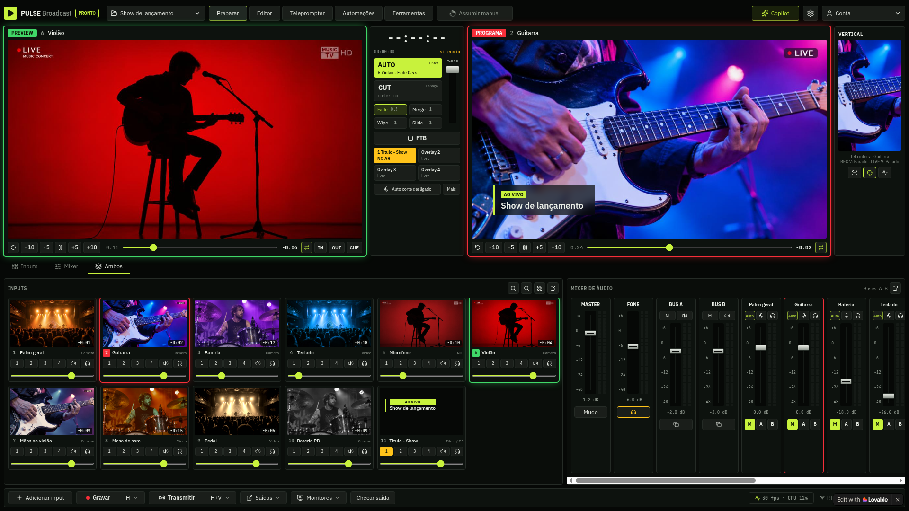

# wMix (PULSE Broadcast)

Software de produção audiovisual e mesa de corte profissional para transmissão ao vivo, inspirado no fluxo de trabalho do vMix.

## 🖥️ Demonstração da Interface
- **Preview e Program (16:9):** Monitores dedicados com sinalização de tally (verde para Preview, vermelho para Programa), controle de playhead e tempo restante.
- **Console Central de Transições:** Botão CUT (corte seco), AUTO com transições suaves (**Fade**, **Merge**, **Wipe**, **Slide**), T-Bar mecânico para controle manual e botão **FTB** (Fade to Black).
- **Dual Canvas (Vertical 9:16):** Monitor vertical sincronizado para transmissões simultâneas em redes sociais (TikTok, Instagram Reels, YouTube Shorts).
- **Overlays (GC / Lower Thirds):** Suporte a até 4 camadas de GC com animação em tempo real.
- **Grade de Entradas (Inputs):** Miniaturas dinâmicas com badges de status, identificação de tipo (Câmera, NDI, Vídeo, GC) e botões de atalho.
- **Mixer de Áudio Multicanal:** Faders de ganho, medidores de VU dinâmicos (verde/amarelo/vermelho), Mute, Cue (pré-escuta de fone) e roteamento de barramento (Master, Bus A, Bus B).

## 🚀 Arquitetura Planejada
- **Desktop:** Tauri + React + TypeScript + Tailwind CSS
- **MVP Audiovisual:** Integração OBS WebSocket v5
- **Evolução:** Avaliação de libobs e múltiplos pipelines

## 🌿 Branches
- : Versões estáveis e documentação
- : Desenvolvimento ativo do frontend e componentes
